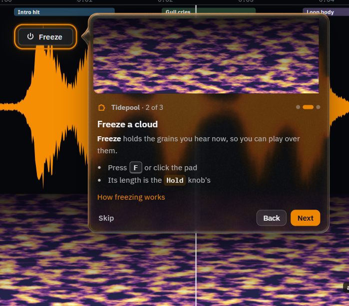
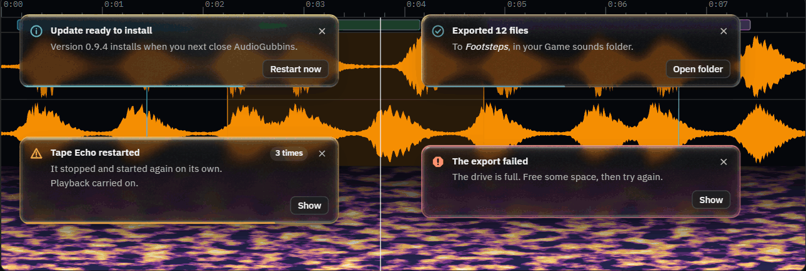
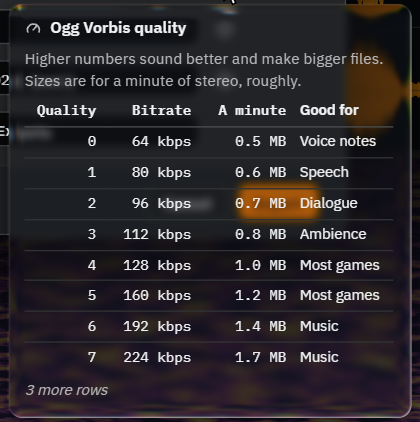
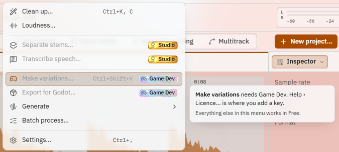
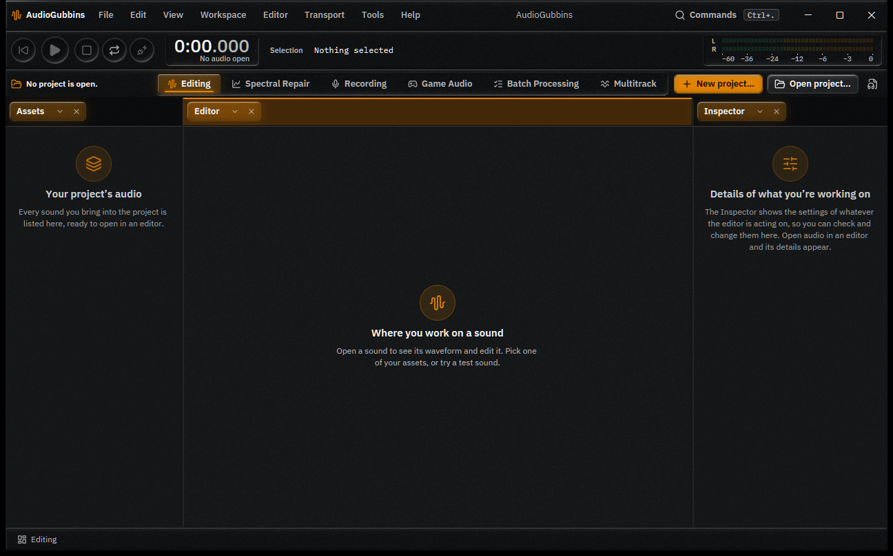

# rustyGubbins

rustyGubbins is a library of controls for desktop apps written in Rust with
[GPUI](https://www.gpui.rs/), the UI framework behind the Zed editor. It's the Rust member of a
family of Gubbins libraries, one for each language.

The controls draw everything from the theme in force, so an app changes its whole look by
changing its theme. The first theme is glass that really refracts what's behind it, and every
control works with the keyboard and a screen reader as well as the mouse.

> **Early days.** rustyGubbins is being built inside [AudioGubbins](#apps-that-use-rustygubbins),
> and its code will move here once it has settled. Until then this repository is where to report
> bugs, suggest features and follow along. The pictures below are design references, drawn to
> the library's own measurements, and the controls are being built to match them.

## What's in it

- **Controls**: buttons, check boxes, switches, sliders, menus and menu bars, tabs,
  text fields, lists, dialogues, progress bars and more, each drawn only from the theme.
- **Refracting glass**: floating surfaces bend and blur what's behind them, with a lit rim that
  follows the pointer. The glass can be turned down a level at a time, to a solid surface for
  anyone who'd rather not have it.
- **Rich hints**: tooltips and callouts take Markdown, with code, lists, small tables, images and
  links, and keep every word at a contrast of 4.5:1 or better over whatever is behind them.
- **The Callout**: a pointer-tailed card for tours, first-run tips and help, which can step
  through several stops.
- **Toasts**: short-lived notices with a severity, an optional action and a count when the same
  thing happens again.
- **Edition badges**: a small badge that marks a feature as part of a paid edition, with the
  reason read out to screen readers.
- **Themes**: dark and light, a high-contrast mode, reduced transparency and two densities.
- **Motion**: animations that ease out and respect the system's reduced-motion setting.
- **Accessibility**: every control reports its role, name and state through
  [AccessKit](https://github.com/AccessKit/accesskit), and focus is always visible.

## Pictures

These are design references for the controls, not screenshots of the finished library.

A Callout with Markdown and an image, stepping through a plug-in's tips:

Toasts, one for each severity, over busy content:

A rich tooltip holding a small table:

Edition badges in a menu, with the reason in a hint:

## Apps that use rustyGubbins

- [AudioGubbins](https://github.com/BootBlock/AudioGubbins): a local-first, non-destructive audio
  editor, and the app rustyGubbins grew out of.

AudioGubbins as it runs today, its menu bar, buttons and tabs drawn by rustyGubbins:

## Getting it

There's no release yet, and the crates aren't on crates.io. This README will say how to add
rustyGubbins to a project once they are.

## Contributing

We're grateful for the thought, but we don't accept pull requests. Please
[open an issue](https://github.com/BootBlock/rustyGubbins/issues/new/choose) instead, and we'll
make the change ourselves. [CONTRIBUTING.md](CONTRIBUTING.md) explains why, and
[SECURITY.md](SECURITY.md) explains how to report a security problem privately.

## Licence

rustyGubbins is licensed under either of

- the Apache License, Version 2.0 ([LICENSE-APACHE](LICENSE-APACHE)), or
- the MIT licence ([LICENSE-MIT](LICENSE-MIT)),

at your option.

Unless you say otherwise, anything you send us to include in rustyGubbins, such as code in an
issue, is licensed the same way, with no further terms.

## Built on

rustyGubbins stands on other people's work, each under its own licence:

- [GPUI](https://github.com/zed-industries/zed/tree/main/crates/gpui), by Zed Industries, under
  the Apache License 2.0;
- [gpui-kit](https://github.com/longbridge/gpui-kit)'s `gpui-base`, by Longbridge, under the
  Apache License 2.0, for the behaviour underneath several controls;
- [AccessKit](https://github.com/AccessKit/accesskit), under MIT or the Apache License 2.0;
- [IBM Plex](https://github.com/IBM/plex) fonts, under the SIL Open Font License 1.1;
- [Lucide](https://lucide.dev/) icons, under the ISC licence.

The full notices will come with the code.
